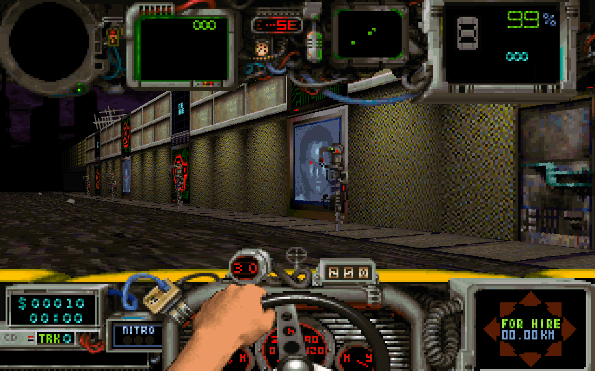
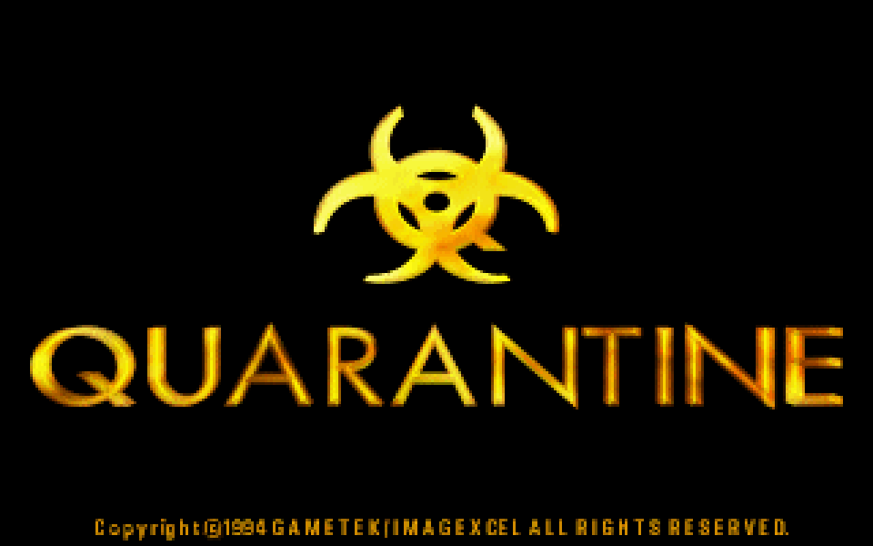
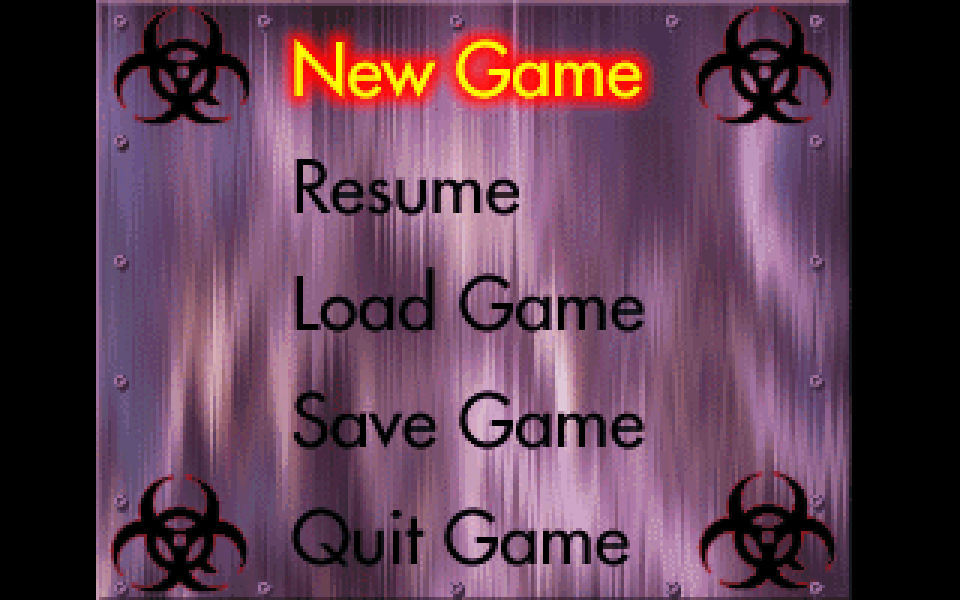
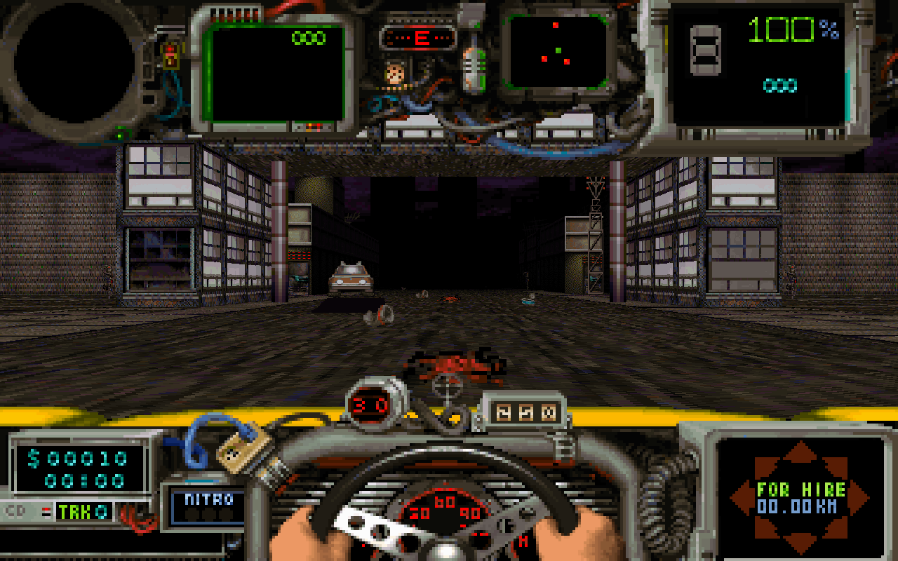
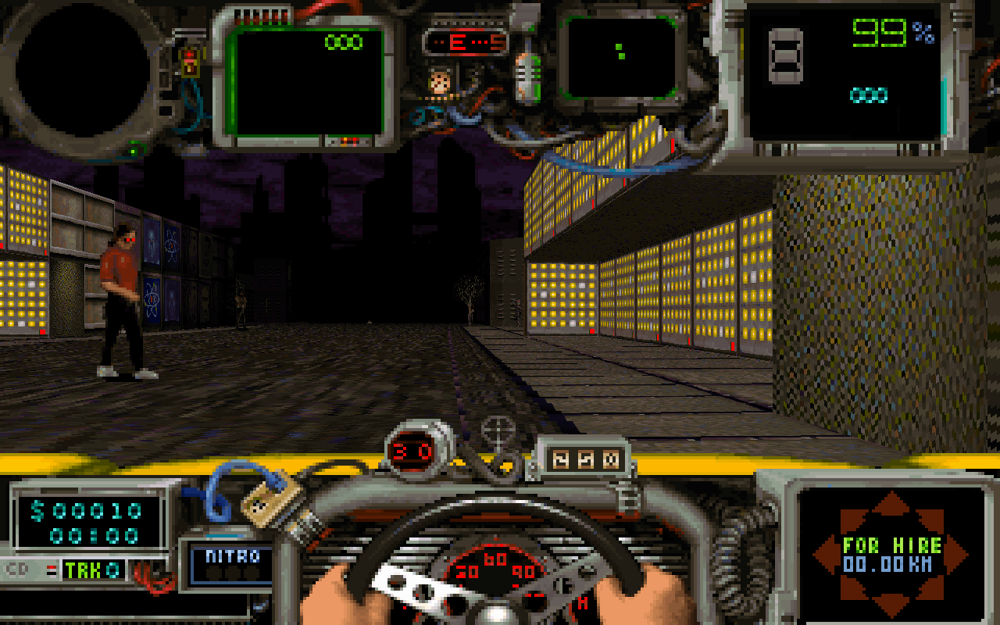
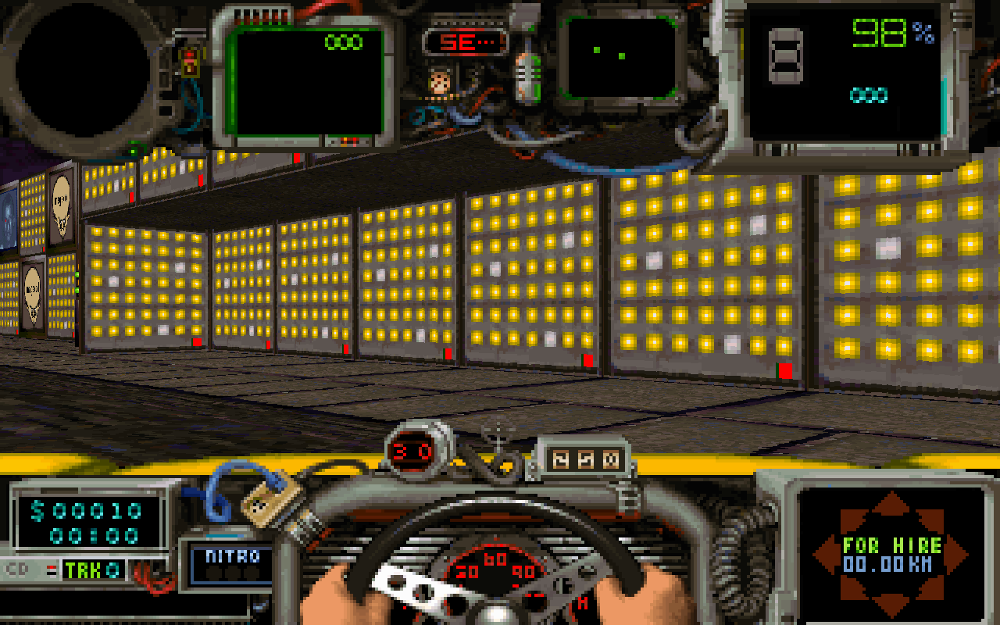
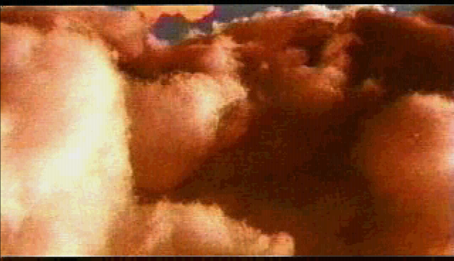
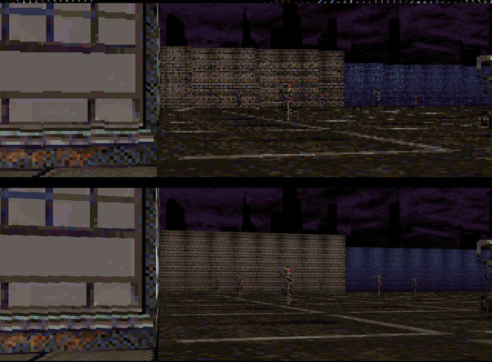

# Quarantine — PC Native

A native Windows port of **Quarantine** (GameTek / Imagexcel, 1994, DOS CD) — the
cyberpunk taxi-combat game in walled-off Kemo City.

The DOS game's own x86 code has been converted to C (static recompilation) and runs on a
small PC runtime that replaces DOS, the DOS/4GW extender, VGA Mode X, the HMI sound
system and the CD drive with PC code. No DOSBox, no emulator.

**You need your own copy of the game** (the CD image). This repository contains no game
files — the installer takes everything from your disc image.



## Features

- **Real 2x / 4x internal resolution** for the 3D view (up to 1280×800) — the game's own
  renderer draws walls, floors, sky, cars and pedestrians at the higher resolution; the
  hand-drawn dashboard keeps its original pixels.
- Upscale filters for everything else: **xBR** (default), bicubic, sharp bilinear,
  bilinear, nearest — plus **FXAA anti-aliasing** and **contrast-adaptive sharpening**.
- Aspect ratio (4:3, stretch, integer), widescreen zoom, window sizes, fullscreen (Alt+Enter).
- **CD music** — the disc's 11 Red Book audio tracks, ripped by the installer and played
  by the port.
- Sound effects, engine sound with speed pitch, radio voices — native mixer.
- The **intro and ending videos** (Duck TrueMotion) with their soundtrack; Esc skips.
- **Frame limit** (default 30 fps) so the game runs at its intended speed on fast PCs.
- The **copy-protection question** is asked only until it is answered right once.

| | |
|---|---|
|  |  |
|  |  |
|  |  |

**320×200 (top) vs 4x internal resolution (bottom), same frame:**



## Install

1. Run **`Quarantine PC Setup.exe`**.
2. Point it at your Quarantine CD: a **Nero image (`.nrg`)**, a **`.cue` with its `.bin`**
   (with the audio tracks), an ISO, a CD drive or a folder copy of the disc.
   Images with the audio tracks give you the CD music; a plain ISO or folder installs the
   game without music.
3. Play from the desktop / Start menu shortcut.

The installer copies the disc, lays out what the DOS installer put on the hard disk, rips
the music tracks and builds the game's icon from the title animation on your CD.
Silent install: `"Quarantine PC Setup.exe" /silent /cd <image|drive|folder> /dir <folder>`.

The first time, the game asks the copy-protection question from the manual's
"Pedestrian weight to impact ratio" table (weight across the top, MPH down the side).
Once answered right it is not asked again (`CopyCheckPassed` in `quarantine_pc.ini`).

## Controls

| Key | |
|---|---|
| ↑ / ↓ | accelerate / brake |
| ← / → | turn |
| Z | hover coils (jump) |
| N | turbo |
| Space | front guns (uzi in side view) |
| Ctrl / Alt | fire / cycle special weapons |
| Enter | horn |
| T | next target |
| E | eject passenger / cancel fare |
| F1 / F2 / F3 | look left / forward / right |
| M | map |
| P | pause |

The menu bar (in a window, Alt+Enter) has the video options; Help → Controls lists these.

## Settings (`quarantine_pc.ini`)

`RenderScale` (1, 2, 4), `Filter`, `Sharpen`, `FXAA`, `Aspect`, `Widescreen`,
`FrameLimit`, `Intro`, `MusicVolume`, `SoundVolume`, `CopyCheckPassed` — all with comments
in the file; most are also in the menu bar.

## How it works

- `tools/recomp.py` turns the DOS programs (`SKIPIT.EXE`, the game; `DUKDOSNA.EXE`, Duck's
  video player) into C; `src/rt` is the PC runtime (DOS, DPMI, BIOS, timer, keyboard,
  MSCDEX with Red Book audio, Direct3D 9 presenter).
- VGA Mode X (planes, page flips, split-screen dashboard) is handled natively
  (`src/rt/native_modex.c`); the game's self-modifying texture span drawers are native
  (`src/game/quarantine.c`).
- The 2x/4x view: the game's frame renderer runs a second time with its projection, floor
  maths, clipping and sprite sizes scaled (`tools/subst_skipit.txt`), drawing into a
  high-resolution layer shown through the dashboard window (`src/game/hires.c`).
- Sound: the game's own sound module is replaced at its entry points
  (`src/rt/native_sound.c`); videos: `src/game/movie.c`.

## Building

Windows Python 3 with `capstone` and `Pillow`, MSYS2 MINGW64 (gcc, SDL2), a copy of the
game CD in `gamedata/cd`:

```
./build.sh gen        # recompile + build quarantine.exe
make release          # Quarantine PC Setup.exe (game exe inside, icon from the user's CD)
```

## Legal

Fan preservation project, not affiliated with GameTek or Imagexcel. Quarantine is ©1994
GameTek / Imagexcel. No game data is included; you need your own copy of the game.
